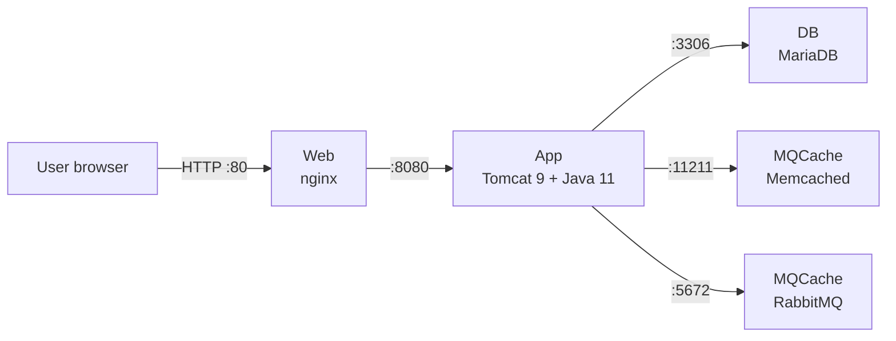

# vProfile on VMware Cloud Director with Terraform

This project provisions the virtual machines for the **vProfile** multi-tier Java application on **VMware Cloud Director (VCD) 10.5** using Terraform. The VMs are created as standalone VMs (no vApps) from a shared catalog template, attached directly to an org VDC network. The services on each VM (nginx, Tomcat, MariaDB, RabbitMQ, Memcached) were then configured manually.

> A second repository automates the service configuration as well, using a first-boot `init.sh` script per VM.

## Architecture



| VM | Role | Services | Ports |
|---|---|---|---|
| Web | Reverse proxy | nginx | 80 |
| App | Application server | Tomcat 9, OpenJDK 11, vProfile `ROOT.war` | 8080 |
| DB | Database | MariaDB (`accounts` database) | 3306 |
| MQCache | Messaging and cache | RabbitMQ, Memcached | 5672, 15672, 11211 |

## Repository structure

```
.
├── providers.tf               # Terraform and VCD provider settings, authentication
├── variables.tf               # Input variable declarations
├── main.tf                    # Catalog/template lookups and the VM resources
├── outputs.tf                 # Prints each VM's IP address
├── terraform.tfvars.example   # Example values (copy to terraform.tfvars)
├── .terraform.lock.hcl        # Pinned provider version
├── .gitignore
└── screenshots/               # Evidence of the deployment
```

## How it works

1. `data "vcd_catalog"` looks up the shared catalog, which is owned by another org (`catalog_org`).
2. `data "vcd_catalog_vapp_template"` finds the Ubuntu template inside it and returns its ID.
3. `resource "vcd_vm"` creates one standalone VM per entry in the `vms` map, cloned from that template, with its CPU, memory and IP settings.
4. Guest customization sets each VM's hostname and IP on first boot.
5. `outputs.tf` prints the IP of every VM after `terraform apply`.

VMs with an `ip` get that address (MANUAL allocation). VMs without one take the next free address from the network's static IP pool (POOL allocation).

## Prerequisites

- Terraform 1.3 or newer
- Access to a VCD 10.5 org with:
  - a user whose role can create and power on VMs (based on vApp Author, plus "Manage user's own API token")
  - an API token for that user
  - an org VDC network with a static IP pool
  - a catalog containing an Ubuntu template with open-vm-tools installed

## Configuration

Copy the example values and edit them for your environment:

```bash
cp terraform.tfvars.example terraform.tfvars
```

Provide the API token as an environment variable, so it is never written to a file.

PowerShell:

```powershell
$env:TF_VAR_vcd_api_token = "your-token"
```

Linux/macOS:

```bash
export TF_VAR_vcd_api_token="your-token"
```

### Variables

| Variable | Description |
|---|---|
| `vcd_url` | VCD API endpoint, for example `https://vcd.example.com/api` |
| `vcd_org` | Org the VMs are created in |
| `vcd_vdc` | Org VDC the VMs are created in |
| `vcd_api_token` | API token (sensitive; set via environment variable) |
| `vcd_allow_unverified_ssl` | Skip certificate checks (lab use only; default `false`) |
| `catalog_org` | Org that owns the template catalog |
| `catalog_name` | Catalog containing the template |
| `template_name` | Template the VMs are cloned from |
| `network_name` | Existing org VDC network to attach the VMs to |
| `vms` | Map of VMs: `cpus`, `memory` (MB), optional `ip` |

## Usage

```bash
terraform init        # download the VCD provider
terraform validate    # check the configuration
terraform plan        # preview the VMs to be created
terraform apply       # create the VMs
terraform output      # show each VM's IP address
terraform destroy     # remove everything when finished
```

## Service configuration

After provisioning, each VM was configured manually:

- **DB:** MariaDB installed, `bind-address` set to `0.0.0.0`, `accounts` database created and the vProfile schema imported, application user granted access.
- **MQCache:** RabbitMQ and Memcached installed; Memcached set to listen on all interfaces; RabbitMQ application user created.
- **App:** OpenJDK 11 and Tomcat 9 installed as a systemd service; `/etc/hosts` entries added for `DB` and `MQCache`; vProfile `ROOT.war` deployed in place of Tomcat's default `ROOT` folder.
- **Web:** nginx installed and configured as a reverse proxy to `App:8080`.

## Validation

The deployment can be verified from the screenshots in `screenshots/`:

1. `terraform apply` completing successfully
2. `terraform output` showing the VM IPs
3. The VMs running in the VCD tenant portal
4. Connectivity checks from the App VM to DB, Memcached and RabbitMQ
5. The vProfile login page opened through nginx on the Web VM

To check the Terraform code without VCD access, run `terraform init` and `terraform validate`.

## Issues encountered and fixes

| Problem | Cause | Fix |
|---|---|---|
| `entity not found` for the catalog | Catalog is owned by another org | Added `org = var.catalog_org` to the catalog data source |
| `Error acquiring the state lock` on Windows | Project folder on a drive that doesn't support file locking | Moved the project to a local disk |
| nginx returned `502 Bad Gateway` | Tomcat on the App VM wasn't running | Fixed the Tomcat installation and service |
| Tomcat failed with `203/EXEC` | Tomcat files missing from `/usr/local/tomcat` | Reinstalled Tomcat into the correct folder |
| `JRE_HOME is not defined correctly` | Service file used a CentOS-style Java path | Pointed `JRE_HOME` to the Ubuntu OpenJDK path |
| App returned 404, `javax/servlet` class not found | vProfile uses Spring 4.2 (`javax`); Tomcat 10 uses `jakarta` | Switched to Tomcat 9 |
| `InaccessibleObjectException` at startup | Spring 4.2 is incompatible with Java 17 | Switched to Java 11 |
| Tomcat welcome page instead of the app | Tomcat's default `ROOT` folder took precedence | Removed it so `ROOT.war` deployed |

## Security notes

- The API token is passed via an environment variable and is never committed.
- `terraform.tfvars` and Terraform state files are excluded by `.gitignore`.
- The vProfile default credentials are used for this lab only and should be changed for any real deployment.
